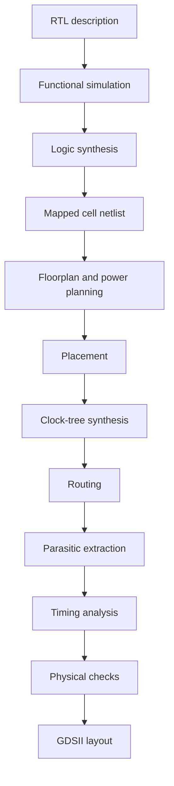
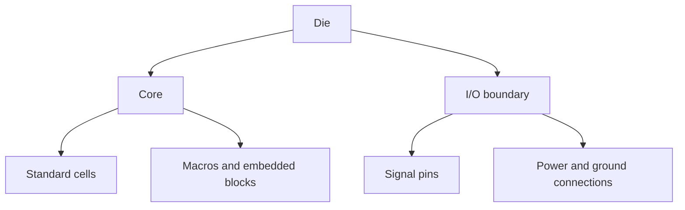
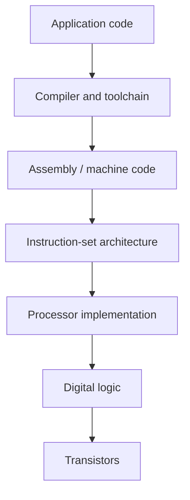
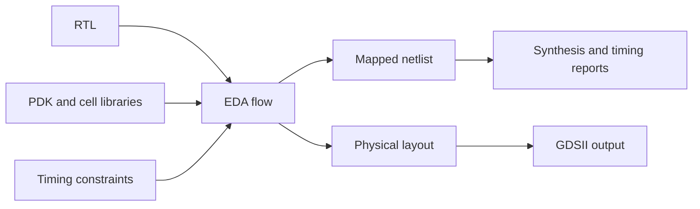
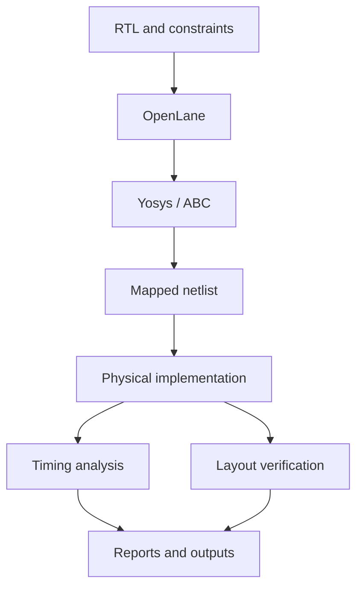
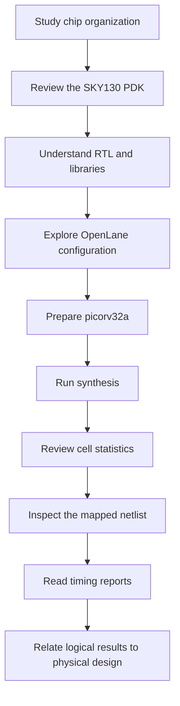

# PHYSICAL DESIGN — Module 1
> **Digital ASIC Design | RTL-to-GDSII | SKY130 | OpenLane | Synthesis and Timing**

## Introduction

This first physical-design session introduces the path from a hardware description to a technology-specific implementation. It combines basic chip organization with an initial hands-on look at the open-source ASIC flow, using the `picorv32a` design as the example.

The learning environment discussed here includes the SKY130 Process Design Kit (PDK), OpenLane, Yosys, ABC, OpenROAD, OpenSTA, Magic, and Docker. The emphasis is on understanding what each stage contributes and learning how to inspect the outputs created during synthesis.

## Contents

1. Learning Targets
2. How an ASIC Moves Toward Layout
3. Chip Regions and Organization
4. Foundry IP and Macro Blocks
5. RISC-V, RTL, and Implementation
6. Software and Hardware Abstraction
7. RTL, EDA Software, and the PDK
8. RTL-to-GDSII Overview
9. Main Physical-Design Operations
10. OpenLane and SKY130
11. Design Setup and Run Files
12. LEF and Standard-Cell Information
13. Synthesis and Its Results
14. Flip-Flop Proportion
15. Gate-Level Netlist
16. Static Timing Analysis
17. Reports and Design Metrics
18. Practical Commands
19. Summary and Conclusions

---

## 1. Learning Targets

By the end of this session, you should be able to:

- Describe the die, core, and I/O pad regions of an integrated circuit.
- Explain the purpose of reusable macros and foundry-provided IP.
- Relate a processor ISA to its RTL implementation.
- Identify the roles of an RTL description, an EDA flow, and a PDK.
- Outline the major stages between RTL and GDSII.
- Recognize common OpenLane and SKY130 files and directories.
- Run or identify the synthesis step and inspect its outputs.
- Interpret basic cell statistics and the flip-flop fraction.
- Read the purpose of a timing report and understand slack.

## 2. How an ASIC Moves Toward Layout

RTL is a logical description of intended circuit behavior; it does not specify the final placement of cells or the routing of metal wires. An implementation flow progressively adds this information and checks the design against electrical, timing, and manufacturing requirements.



The stages may involve iterations. If a timing or physical check fails, the design or its constraints may need to be adjusted before continuing.

## 3. Chip Regions and Organization

An integrated circuit is commonly described in terms of its **die**, **core**, and **I/O pads**.

- **Die:** the complete silicon region containing the chip.
- **Core:** the main area in which most standard cells and internal logic are placed.
- **I/O pads:** interface structures that connect internal circuitry to signals, power, and ground outside the core.


A simplified view of the relationship is:



The way these regions are arranged can influence routing distance, congestion, power delivery, and signal timing.

## 4. Foundry IP and Macro Blocks

A system-on-chip often combines ordinary synthesized logic with larger or specialized blocks that already have defined interfaces and physical implementations.

### Foundry or technology-specific IP

Examples may include PLLs, analog-to-digital converters, digital-to-analog converters, and I/O interface circuitry. Their availability and implementation depend on the process and the design platform.

### Macros

A macro is a reusable block handled as a larger physical object during implementation. Common examples include SRAMs, embedded memories, processor blocks, and accelerators.


Unlike ordinary RTL logic, a hard macro is generally placed as a unit rather than being decomposed into standard cells by the usual synthesis process. Its pins, dimensions, and placement constraints must be considered during floorplanning and routing.

## 5. RISC-V, RTL, and Implementation

RISC-V is an **Instruction Set Architecture (ISA)**: it defines the instructions and programmer-visible behavior supported by a processor. It does not prescribe one particular physical design.

Different processor designs can implement the same ISA using different microarchitectures and RTL.


The `picorv32` family provides a compact RISC-V processor implementation suitable for studying this connection.


The key distinction is that the ISA describes what the processor should do, while RTL and the later implementation stages describe how a particular design realizes that behavior.

## 6. Software and Hardware Abstraction

Software passes through multiple levels before instructions are executed by hardware.



A separate implementation path is used to build the hardware itself:

```text
RTL source
   ↓
Logic synthesis
   ↓
Gate-level netlist
   ↓
Physical design
   ↓
Layout data
```

These paths meet when the manufactured processor executes the machine instructions produced by the software toolchain.

## 7. RTL, EDA Software, and the PDK

Three ingredients are central to a technology-specific digital ASIC flow.

### RTL

Register Transfer Level descriptions express the circuit's behavior and are commonly written in Verilog, SystemVerilog, or VHDL. This example uses Verilog RTL.

### EDA tools

Electronic Design Automation software automates synthesis, physical implementation, timing analysis, and layout inspection.

| Tool | Main role in this flow |
|---|---|
| Yosys | RTL synthesis and logic transformations |
| ABC | Logic optimization and technology mapping |
| OpenROAD | Physical-design operations |
| OpenSTA | Static timing analysis |
| Magic | Layout viewing and physical checks |
| OpenLane | Flow orchestration and configuration |
| Docker | Isolated, reproducible software environment |

### Process Design Kit (PDK)

A PDK provides the process-specific information needed by design tools. For SKY130, relevant data can include standard-cell libraries, timing models, layout abstracts, layer definitions, electrical models, and design-rule information.




The RTL defines the logic, the PDK describes the target technology, and the constraints tell the tools what implementation requirements to meet.

## 8. RTL-to-GDSII Overview

The flow from source code to layout includes both logical and physical operations.


A simplified sequence is:

1. Review RTL and functional behavior.
2. Synthesize the design into a gate-level netlist.
3. Define the floorplan and power network.
4. Place standard cells.
5. Build the clock distribution network.
6. Route signal connections.
7. Extract interconnect parasitics.
8. Check timing and physical rules.
9. Produce the final layout database, such as GDSII, when the flow is complete.

The exact flow and names of the steps vary with the OpenLane version, configuration, and design requirements.

## 9. Main Physical-Design Operations

### Synthesis

Synthesis transforms RTL into logic cells supported by the selected library. Optimization and technology mapping determine which cells implement the design.

### Floorplanning

Floorplanning establishes the die and core dimensions and the intended positions of macros and I/O. Core utilization and aspect ratio are important planning parameters.

### Placement

Placement assigns physical positions to standard cells. Tools try to balance timing, wire length, density, congestion, and routability.

### Clock-tree synthesis (CTS)

CTS builds a network to distribute the clock to sequential cells while managing delay and skew. Buffers and inverters may be inserted to improve clock delivery.

### Routing

Routing connects cell pins with metal wires and vias. The router must respect the technology's layer and spacing rules while satisfying connectivity and timing goals.

### Static timing analysis (STA)

STA evaluates timing paths using cell timing models, constraints, and—when available—interconnect parasitics. It reports values such as arrival time, required time, and slack.

A typical register-to-register path is:

```text
Launch register
      ↓
Combinational cells
      ↓
Interconnect
      ↓
Capture register
```

## 10. OpenLane and SKY130

OpenLane combines tools into an automated implementation flow. In a typical setup, Yosys and ABC handle synthesis, OpenROAD-based tools perform physical-design tasks, OpenSTA evaluates timing, and layout-related tools support physical verification.



### SKY130 PDK organization

A simplified view of a SKY130 installation is shown below. Exact directory names can differ by distribution and installation.

```text
sky130A/
├── libs.ref/
│   ├── sky130_fd_sc_hd/
│   ├── sky130_fd_sc_hs/
│   └── memory-related libraries
└── libs.tech/
    ├── magic/
    ├── openlane/
    ├── klayout/
    └── other tool-specific data
```


Useful file categories include:

| File type | Typical contents |
|---|---|
| `.lib` | Cell timing and power models |
| `.lef` | Cell and macro physical abstracts |
| `.tlef` | Technology-layer and routing information |
| `.v` | Verilog models or cell declarations |
| `.spice` | Transistor-level circuit models |
| `.gds` | Physical layout geometry |

## 11. Design Setup and Run Files

A design directory normally contains RTL, timing constraints, and configuration information. For the example design, the structure may resemble:

```text
designs/
└── picorv32a/
    ├── config.tcl
    ├── src/
    │   ├── picorv32a.v
    │   └── picorv32a.sdc
    └── other design files
```

The configuration describes the design name, source files, clock details, selected PDK and library, utilization targets, and other flow settings. The SDC file supplies timing constraints.

### Docker environment

Docker can provide a consistent environment with the required tool versions.


To check which Docker images are available locally:

```bash
docker images
```

A container command depends on how OpenLane and the PDK were installed. The following is an example for an environment that uses the corresponding image and mount points:

```bash
docker run -it \
  -v "$PWD:/openLANE_flow" \
  -v "$PDK_ROOT:$PDK_ROOT" \
  -e PDK_ROOT="$PDK_ROOT" \
  efabless/openlane:v0.21
```

Follow the instructions for your installed version; image tags, paths, permissions, and startup commands may differ.

### Preparing a run

In an OpenLane interactive Tcl environment, a common preparation command for this example is:

```tcl
prep -design picorv32a
```


Preparation creates a run-specific working directory. A typical layout is:

```text
runs/
└── <run-id>/
    ├── config.tcl
    ├── logs/
    ├── reports/
    ├── results/
    └── tmp/
```

| Location | What to look for |
|---|---|
| `logs/` | Tool messages and execution records |
| `reports/` | Statistics, timing, and check reports |
| `results/` | Generated netlists and implementation files |
| `tmp/` | Intermediate files used by the flow |
| `config.tcl` | Configuration resolved for this run |

## 12. LEF and Standard-Cell Information

A merged LEF file combines physical abstracts needed by the implementation flow. It can describe cell dimensions, pin geometry, routing layers, and macro boundaries.


LEF and Liberty files serve different purposes:

| File | Main use |
|---|---|
| LEF (`.lef`) | Physical dimensions, pins, and routing abstracts |
| Liberty (`.lib`) | Timing, power, and logical cell characteristics |

Physical implementation needs the geometric view as well as the cell's logical and timing characteristics.

## 13. Synthesis and Its Results

Within the appropriate OpenLane interactive session, the synthesis step may be started with:

```tcl
run_synthesis
```

The flow uses the RTL, constraints, and selected standard-cell library to create a mapped gate-level netlist. The reports can include cell counts, wire statistics, area estimates, and timing information.


### Synthesis statistics

Yosys reports quantitative information about the resulting design, for example:

- Number of cells and cell types
- Number of wires and wire bits
- Number of sequential elements
- Number of combinational cells
- Area information, when available


Use the values from your own synthesis run when documenting a result, since counts can change with source versions, constraints, library selection, and flow settings.

## 14. Flip-Flop Proportion

The flip-flop fraction gives a rough indication of how many mapped cells are sequential storage elements.

The reference run described in the source material reported:

```text
Flip-flops: 1,613
Total cells: 14,876
```

The percentage is calculated as:

\[
\text{Flip-flop fraction} =
\frac{\text{Flip-flop count}}{\text{Total cell count}}\times 100
\]

Using those reported values:

\[
\frac{1613}{14876}\times100 \approx 10.84\%
\]

This percentage applies to that particular synthesis result. It should not be treated as a fixed property of all RISC-V designs or all `picorv32a` builds. The cell categories included in the total also matter.

## 15. Gate-Level Netlist

The mapped netlist is a structural representation of the design. Instead of describing only high-level behavior, it instantiates library cells and connects their pins with nets.

```text
RTL behavior
    ↓
Logic transformations
    ↓
Technology mapping
    ↓
Cell instances and connections
    ↓
Gate-level Verilog netlist
```


The mapped netlist is a key input to later physical-design stages. Its size and structure depend on the RTL, synthesis options, and target library.

## 16. Static Timing Analysis

Static timing analysis evaluates whether paths meet the timing constraints without relying on simulation of every possible input sequence.

A path report may contain:

- Startpoint and endpoint
- Clock and path type
- Cell and net delay
- Signal slew and capacitance
- Arrival and required times
- Setup or hold slack


For a simplified setup path, the clock period must accommodate the launch register delay, combinational logic, interconnect, and capture register setup requirement, with clock effects considered by the timing engine.

A common interpretation of slack is:

```text
Slack = Required time - Arrival time
```

- **Positive slack:** the analyzed path meets the stated timing requirement.
- **Negative slack:** the path violates the relevant timing requirement.

Timing results depend on the constraints and analysis assumptions, including clock definitions, input/output delays, library models, and process-voltage-temperature conditions.

## 17. Reports and Design Metrics

The run's reports directory may contain synthesis statistics, timing summaries, slew or capacitance checks, and other tool-specific output.


Physical design also involves several related metrics:

- **Area:** the amount of physical space occupied by cells or the overall design.
- **Utilization:** how much of the available core area is occupied by placed cells, according to the tool's definition.
- **Congestion:** pressure on available routing resources.
- **Timing:** whether the design meets the requested delay constraints.
- **Power:** energy or power consumed by the circuit under stated operating assumptions.

These metrics interact. For example, high utilization can leave less room for routing, which may increase congestion and make timing closure more difficult. A design therefore needs balanced optimization rather than focusing on a single metric.

## 18. Practical Commands

Commands below are examples associated with the described OpenLane setup. Use the syntax supported by the version installed in your environment.

### Inspect available Docker images

```bash
docker images
```

### Start an OpenLane container

```bash
docker run -it \
  -v "$PWD:/openLANE_flow" \
  -v "$PDK_ROOT:$PDK_ROOT" \
  -e PDK_ROOT="$PDK_ROOT" \
  efabless/openlane:v0.21
```

### Launch the interactive flow

```bash
./flow.tcl -interactive
```

### Load the OpenLane package

```tcl
package require openlane 0.9
```

### Prepare the example design

```tcl
prep -design picorv32a
```

### Run synthesis

```tcl
run_synthesis
```

If a command fails, check the installed OpenLane version, current working directory, PDK path, Docker mounts, and the tool log before changing the configuration.

## 19. Important Files to Recognize

| File or output | Why it matters |
|---|---|
| `picorv32a.v` | RTL source for the design |
| `picorv32a.sdc` | Timing constraints, where supplied |
| `config.tcl` | Flow and design configuration |
| Merged LEF | Combined physical cell and macro abstracts |
| Synthesized Verilog | Technology-mapped netlist |
| `.lib` files | Cell timing and power data |
| `.lef` files | Physical abstracts for cells and macros |
| Synthesis reports | Cell and area statistics |
| STA reports | Timing-path and slack information |

Exact filenames and report locations may vary by OpenLane release and configuration.

## 20. Logical View Compared with Physical View

| Logical design information | Physical implementation information |
|---|---|
| RTL behavior | Cell placement and layout |
| Boolean logic | Library cell instances |
| Nets and signal names | Metal routes and vias |
| Clock constraints | Clock distribution network |
| Mapped netlist | Placed-and-routed design |
| Ideal or estimated delay | Delay including implementation effects |

The implementation flow links these views step by step. Synthesis establishes the cell-level logic, while placement, routing, and parasitic analysis reveal how the physical structure affects the design.

## Key Observations

1. **RTL and layout describe different levels of abstraction.** RTL expresses behavior; layout records physical geometry.
2. **The PDK ties the design to a manufacturing technology.** Cell choices, layer definitions, timing models, and design rules all matter.
3. **Synthesis maps logic to real library cells.** The resulting netlist is the starting point for physical implementation.
4. **Timing depends on more than logic depth.** Cell characteristics, wire parasitics, and clock effects all contribute.
5. **Reports should be read alongside configuration files.** Statistics only make sense when the design, library, constraints, and flow settings are known.

## Learning Sequence



## Conclusion

This session establishes the background needed for digital physical design. Chip organization, the PDK, standard-cell libraries, and the RTL-to-GDSII sequence provide the context for the first practical synthesis experiment. Preparing `picorv32a`, reviewing the generated netlist, and examining cell statistics and timing reports help explain how a behavioral description becomes a technology-mapped circuit.

The main lesson is that a successful implementation depends on the interaction between **logic, the target process, timing constraints, and physical geometry**. These fundamentals support later work on floorplanning, placement, clock-tree synthesis, routing, parasitic extraction, timing closure, and physical verification.
