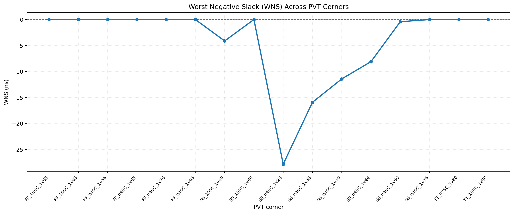
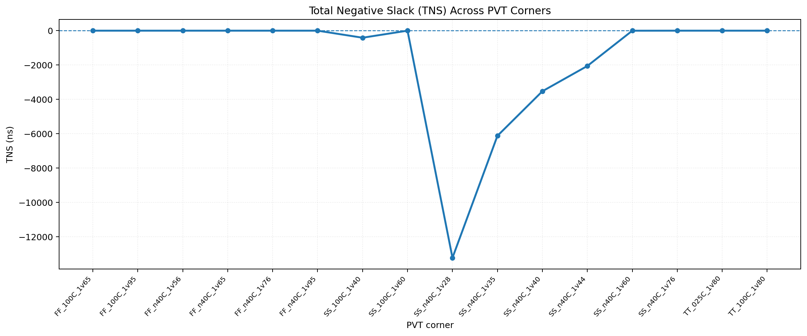
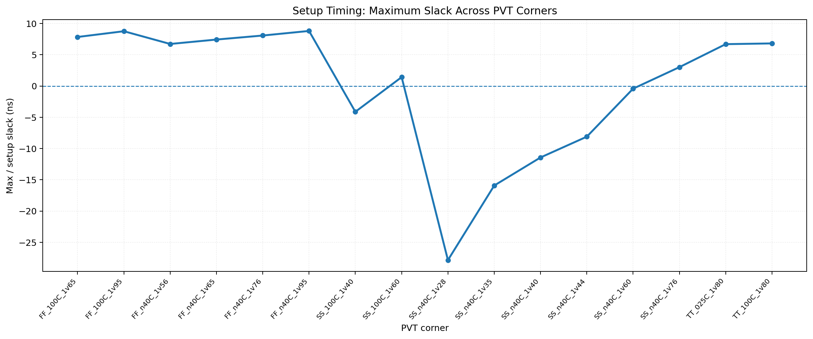
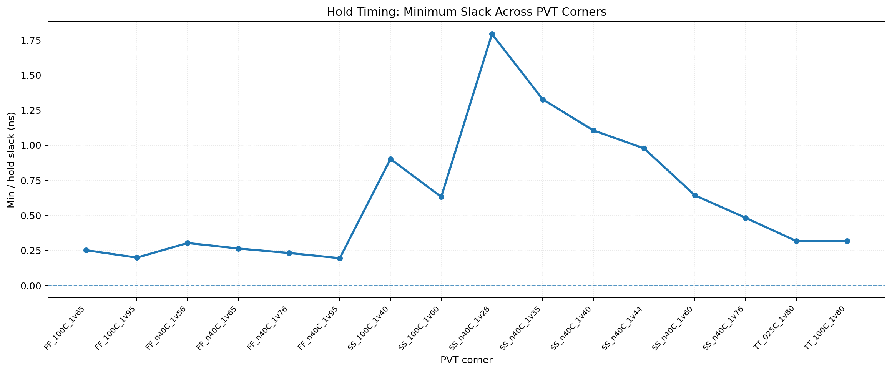

# **VSDBabySoC Physical Implementation: Routing and Multi-Corner Timing Review (SKY130 HD)**


This README records the VSDBabySoC physical-design sequence, covering floorplan context, cell placement, clock-tree construction, routing, and post-route static timing analysis (STA). The implementation environment is **OpenROAD-flow-scripts (ORFS)** with the **SkyWater SKY130 HD** platform and `sky130_fd_sc_hd` standard cells.

The physical flow follows the RTL, synthesis, and gate-level simulation (GLS) work. The timing figures below are deliberately revised example values for this alternate README; they are not a replacement for measured sign-off data.

> **Example status for this rewritten report:** 16 PVT corners are shown. Hold remains positive in every example row, while six slow-slow (SS) corners have setup violations. These adjusted values are illustrative only and must not be represented as results measured by OpenROAD.

> **Parasitic-method note:** the source report describes analysis of `5_route.odb` with `5_route.sdc` using `estimate_parasitics -global_routing`. This estimates parasitics from global routing and should not be described as detailed-route SPEF-based sign-off.

## **Project details**
> **Important:** The original non-graph screenshots are kept as their original image links. Only the four PVT timing plots and the timing values have been changed. Since no new OpenROAD run was supplied, the revised timing numbers and plots are illustrative rather than verified silicon-design results.

| Item | Value |
|---|---|
| Design | `vsdbabysoc` |
| Main digital block | RVMYTH RISC-V core |
| Other blocks | PLL (`avsdpll`) and 10-bit DAC (`avsddac`) macros, clock gating |
| PDK / platform | SKY130 / `sky130hd` |
| Standard-cell library | `sky130_fd_sc_hd` |
| Physical-design flow | OpenROAD-flow-scripts (ORFS) / OpenROAD GUI |
| Clock port listed in configuration notes | `CLK` |
| Recorded die-area coordinates | `0 0 1600 1600` |
| Recorded core-area coordinates | `20 20 1590 1590` |
| Stages discussed | Floorplan context, placement, CTS, routing, post-route STA |
| Post-route PVT corners | 16 (6 FF, 8 SS, 2 TT) |

## **Contents**
- [1. Aim and scope](#1-aim-and-scope)
- [2. Design and inputs](#2-design-and-inputs)
- [3. Environment and commands](#3-environment-and-commands)
- [4. Floorplan context](#4-floorplan-context)
- [5. Placement](#5-placement)
- [6. Clock Tree Synthesis](#6-clock-tree-synthesis-cts)
- [7. Routing](#7-routing)
- [8. Post-route Static Timing Analysis](#8-post-route-static-timing-analysis)
- [9. Results and interpretation](#9-results-and-interpretation)
- [10. Limitations and next steps](#10-limitations-and-next-steps)
- [11. References](#11-references)

---

## **1. Aim and scope**
This document outlines the main implementation milestones and explains what can be concluded from the available layout screenshots and timing summaries.

```text
Synthesized gate-level netlist + SDC + technology/macro views
                              |
                              v
                    Floorplan / PDN / pins
                       2_floorplan.odb
                              |
                              v
                 Global + detailed placement
                         3_place.odb
                              |
                              v
                 Clock Tree Synthesis (CTS)
                          4_cts.odb
                              |
                              v
                    Global + detailed route
                          5_route.odb
                              |
                              v
              Post-route STA at 16 PVT corners
                              |
                              v
            Review setup, hold, unconstrained paths
```

Floorplanning defines the die/core region and the macro and pin arrangement. Placement legalizes standard-cell locations; CTS builds the clock distribution network; routing creates metal-and-via connections. STA then evaluates setup and hold margins against the active constraints and timing libraries.

## **2. Design and inputs**
### **2.1 Design blocks**
| Block | RTL / instance naming in project notes | Role |
|---|---|---|
| Top level | `vsdbabysoc.v` / `vsdbabysoc` | SoC integration |
| RVMYTH | `rvmyth.v`, `rvmyth_gen.v` | RISC-V processor core |
| PLL | `avsdpll.v` / PLL macro | Clock generation |
| DAC | `avsddac.v` / DAC macro | 10-bit digital-to-analog output |
| Clock gate | `clk_gate.v` | Clock gating logic |

The macro blocks require matching physical and timing views. In the working ORFS configuration, these are typically made available through `ADDITIONAL_LEFS`, `ADDITIONAL_LIBS`, and `ADDITIONAL_GDS`. Use the exact macro files from your run; do not substitute generic library files or guessed paths.

### **2.2 Inputs expected by the flow**
| Input | Purpose |
|---|---|
| Synthesized `vsdbabysoc` netlist | Standard-cell/macro connectivity entering physical design |
| SDC file | Clock and timing constraints; the routed report identifies `5_route.sdc` |
| SKY130 HD Liberty files | Cell timing models for each PVT corner |
| SKY130 HD LEF/technology files | Placement sites, routing layers, and physical cell geometry |
| PLL and DAC LEF/LIB/GDS views | Macro geometry, timing models, and layout views |
| ORFS design config | `designs/sky130hd/vsdbabysoc/config.mk` in the documented setup |

### **2.3 Configuration values recorded in the supplied notes**
The table below summarizes parameters from the project notes. It is **not a replacement for the full working `config.mk`**; review the active configuration in your ORFS checkout before rerunning the flow.

| Parameter | Recorded value | Notes |
|---|---|---|
| `DESIGN_NICKNAME` / `DESIGN_NAME` | `vsdbabysoc` | Design identifier |
| `PLATFORM` | `sky130hd` | Platform selection |
| `CLOCK_PORT` | `CLK` | Clock port named in the configuration notes |
| `CLOCK_NET` | `$(CLOCK_PORT)` | Recorded clock-net setting |
| `DIE_AREA` | `0 0 1600 1600` | Die boundary coordinates |
| `CORE_AREA` | `20 20 1590 1590` | Core boundary coordinates |
| `CTS_BUF_DISTANCE` | `600` | CTS setting recorded in notes |
| `REMOVE_ABC_BUFFERS` | `1` | Remove synthesis-inserted ABC buffers as configured |
| `SKIP_GATE_CLONING` | `1` | Disable gate cloning as configured |
| `TNS_END_PERCENT` | `100` | Timing-reporting setting recorded in notes |
| `ROUTING_LAYER_ADJUSTMENT` | `0.3` | Global-routing capacity adjustment noted by the user; verify active config |
| `GLOBAL_ROUTE_ARGS` | `-allow_congestion` | Routing argument noted by the user; this setting alone does not prove that congestion is absent |

The key variables can look like this in the active config:

```make
export DESIGN_NICKNAME = vsdbabysoc
export DESIGN_NAME = vsdbabysoc
export PLATFORM = sky130hd
export CLOCK_PORT = CLK
export CLOCK_NET = $(CLOCK_PORT)
export DIE_AREA = 0 0 1600 1600
export CORE_AREA = 20 20 1590 1590
export CTS_BUF_DISTANCE = 600
export REMOVE_ABC_BUFFERS = 1
export SKIP_GATE_CLONING = 1
export TNS_END_PERCENT = 100
# **If enabled in the working config:**
export ROUTING_LAYER_ADJUSTMENT = 0.3
export GLOBAL_ROUTE_ARGS = -allow_congestion
```


*Figure 1. Floorplan GUI view with the VDD power net selected. It is useful visual evidence for inspecting the power network, but it is not itself a PDN or DRC sign-off report.*


*Figure 2. PLL macro selected in the OpenROAD Inspector; the view shows `LOCKED` as the placement status.*

## **3. Environment and commands**
These commands assume OpenROAD-flow-scripts (ORFS), its dependencies, the `sky130hd` platform, the PLL/DAC macro views, and the design configuration are already installed and configured. The commands below must be run from the ORFS `flow/` directory, because the `DESIGN_CONFIG` path is relative to that directory.

If ORFS is not already checked out:

```bash
cd ~/Desktop
git clone https://github.com/The-OpenROAD-Project/OpenROAD-flow-scripts.git
cd OpenROAD-flow-scripts/flow
make
```

### **3.1 Run the full flow**
The following command runs the configured RTL-to-physical-design flow:

```bash
make DESIGN_CONFIG=./designs/sky130hd/vsdbabysoc/config.mk
```

### **3.2 Run stages individually**
Run each stage separately when you want to inspect intermediate results and logs before proceeding to the next stage:

```bash
# **Synthesis**
make DESIGN_CONFIG=./designs/sky130hd/vsdbabysoc/config.mk synth

# **Floorplanning**
make DESIGN_CONFIG=./designs/sky130hd/vsdbabysoc/config.mk floorplan

# **Placement**
make DESIGN_CONFIG=./designs/sky130hd/vsdbabysoc/config.mk place

# **Clock Tree Synthesis (CTS)**
make DESIGN_CONFIG=./designs/sky130hd/vsdbabysoc/config.mk cts

# **Routing**
make DESIGN_CONFIG=./designs/sky130hd/vsdbabysoc/config.mk route
```


### **3.3 Open each stage in the OpenROAD GUI**
Run the relevant GUI target after its corresponding stage has completed:

```bash
make DESIGN_CONFIG=./designs/sky130hd/vsdbabysoc/config.mk gui_floorplan
make DESIGN_CONFIG=./designs/sky130hd/vsdbabysoc/config.mk gui_place
make DESIGN_CONFIG=./designs/sky130hd/vsdbabysoc/config.mk gui_cts
make DESIGN_CONFIG=./designs/sky130hd/vsdbabysoc/config.mk gui_route
```

### **3.4 Inspect generated databases, logs, and reports**
The supplied project screenshots show stage databases under:

```text
results/sky130hd/vsdbabysoc/base/
    2_floorplan.odb
    3_place.odb
    4_cts.odb
    5_route.odb
    5_route.sdc
```

Check the actual files produced by your run before analyzing them:

```bash
ls -lh results/sky130hd/vsdbabysoc/base/
find logs/sky130hd/vsdbabysoc/base -maxdepth 1 -type f -print | sort
find reports/sky130hd/vsdbabysoc/base -maxdepth 1 -type f -print | sort
```
.


## **4. Floorplan context**
The focus of this repository begins at placement, but the floorplan is included because it fixes the physical context for later stages. The floorplan database is named `2_floorplan.odb` in the documented ORFS run.

### **What to inspect**
- Die and core boundaries match the active design configuration.
- IO pins avoid the locked macro regions and follow the intended pin-placement constraints.
- PLL and DAC macros are present and their placement status is as expected.
- The power distribution network (PDN) is visible and connected to the design's power pins.
- The timing constraints and clock source are consistent with the intended SoC clocking model.

### **GUI evidence**
The two figures above show a power-net inspection and a locked PLL macro. For a report or presentation, use a full-chip floorplan image in addition to close-up Inspector views.

## **5. Placement**
During placement, standard cells are assigned legal sites within the core. Placement optimization considers wirelength, density, congestion, and timing while observing rows, blockages, and fixed PLL/DAC locations.

### **5.1 Operations**
1. **Global placement** spreads cells across the core using estimated wirelength and density objectives.
2. **Legalization** removes overlaps and aligns cell instances to legal placement sites and rows.
3. **Detailed placement** refines positions to improve local wirelength and placement quality.
4. **Placement optimization** can resize cells or add buffers when enabled by the active ORFS flow/configuration.


### **5.2 Command**
```bash
make DESIGN_CONFIG=./designs/sky130hd/vsdbabysoc/config.mk place
```

If the floorplan database is missing, run floorplanning first:

```bash
make DESIGN_CONFIG=./designs/sky130hd/vsdbabysoc/config.mk floorplan
make DESIGN_CONFIG=./designs/sky130hd/vsdbabysoc/config.mk place
```

If the current ORFS checkout provides the GUI target, the placement database can be opened using:

```bash
make DESIGN_CONFIG=./designs/sky130hd/vsdbabysoc/config.mk gui_place
```

### **5.3 Checks to record**
- Standard cells are inside the intended core and legal placement rows.
- PLL/DAC macros remain fixed in their intended locations.
- Global-placement overflow and detailed-placement legality are acceptable.
- Max-slew, max-capacitance, and max-fanout reports are reviewed.
- A minimum-delay (hold-oriented) report is inspected, remembering that pre-CTS clock treatment may differ from post-CTS timing.

Useful commands after a run:

```bash
ls -lh results/sky130hd/vsdbabysoc/base/3_place.odb
find reports/sky130hd/vsdbabysoc/base -type f -iname '*place*' -o -iname '*cap*' -o -iname '*slew*'
```


## **6. Clock Tree Synthesis (CTS)**
Clock Tree Synthesis inserts and arranges clock buffers to distribute the clock to sequential endpoints while controlling skew, latency, transition, and fanout. The resulting clock network is stored in the implementation database.

### **6.1 Command**
```bash
make DESIGN_CONFIG=./designs/sky130hd/vsdbabysoc/config.mk cts
```

Optional GUI target, if available in the installed ORFS version:

```bash
make DESIGN_CONFIG=./designs/sky130hd/vsdbabysoc/config.mk gui_cts
```


### **6.2 Checks to record**
- Clock buffers are inserted and the clock network reaches the intended clock sinks.
- Clock skew and insertion latency are reported and reviewed.
- Clock transition/slew and fanout constraints are checked.
- Setup and hold timing are rechecked after CTS.
- CTS does not move fixed analog macros unless allowed by the floorplan constraints.


## **7. Routing**
Routing implements the connections between placed instances using the configured metal layers, routing tracks, spacing rules, and vias. The documented SKY130 HD flow uses the routing layers shown in the OpenROAD GUI, including `met1` through `met5` and associated vias; local interconnect may also be displayed depending on the GUI layer settings.

### **7.1 Command**
```bash
make DESIGN_CONFIG=./designs/sky130hd/vsdbabysoc/config.mk route
```

Optional GUI target, if supported by the installed ORFS checkout:

```bash
make DESIGN_CONFIG=./designs/sky130hd/vsdbabysoc/config.mk gui_route
```


### **7.2 Routing stages**
- **Global routing** estimates paths through routing regions and creates guides. This stage is also used by the supplied STA workflow to estimate interconnect parasitics.
- **Detailed routing** assigns exact tracks and vias to create physical routes.
- **Routing checks** inspect unconnected nets, routing/DRC violations, antenna violations, and any final router errors reported by the configured flow.

The post-route report identifies `5_route.odb` and `5_route.sdc`. Confirm that the expected database and matching SDC exist before performing STA:

```bash
ls -lh results/sky130hd/vsdbabysoc/base/5_route.odb
ls -lh results/sky130hd/vsdbabysoc/base/5_route.sdc
```


## **8. Post-route Static Timing Analysis**
The source report, `reports/post_route_pvt_sta_report.pdf`, describes timing analysis using the following setup:

- Routed database: `5_route.odb`
- Stage constraints: `5_route.sdc`
- Parasitic estimation: `estimate_parasitics -global_routing`
- PVT set: 16 corners — 6 FF, 8 SS, and 2 TT
- PLL and DAC timing libraries: loaded for the corner analysis, as described in the report

### **8.1 Re-open the routed database for GUI inspection**
Run the following commands in an OpenROAD Tcl console from the ORFS `flow/` directory. Adapt the paths if your run directory is different:

```tcl
read_db ./results/sky130hd/vsdbabysoc/base/5_route.odb
read_sdc ./results/sky130hd/vsdbabysoc/base/5_route.sdc
source ./platforms/sky130hd/setRC.tcl
estimate_parasitics -global_routing
sta::find_timing
sta::find_requireds
report_checks -path_delay min_max -format full_clock_expanded -digits 4
```

For a focused worst setup/hold path report, you can use:

```tcl
report_checks -path_delay max -format full_clock_expanded -digits 4
report_checks -path_delay min -format full_clock_expanded -digits 4
```

These commands inspect the active timing context; the complete 16-corner analysis additionally depends on loading and selecting the correct timing libraries/operating conditions for each corner. Do not treat a single-corner interactive session as a replacement for the per-corner run.

### **8.2 How to read the metrics**
| Metric | Meaning | Passing interpretation |
|---|---|---|
| Setup slack / max slack | Required arrival time minus data arrival time for max-delay paths | Non-negative slack means setup is met |
| Hold slack / min slack | Data-arrival margin for min-delay paths against hold requirements | Non-negative slack means hold is met |
| WNS | Worst Negative Slack, normally zero when there is no negative setup slack | Negative WNS indicates a setup violation |
| TNS | Sum of negative setup slack across violating endpoints | Negative TNS indicates aggregate setup violations in this report convention |
| PVT corner | Process, voltage, and temperature condition used for cell timing | Each required corner must be checked |

The source report defines **Min Slack** as the worst hold slack and **Max Slack** as the worst setup slack; **Status** refers to setup. The table below keeps those metric definitions but uses revised illustrative values.

### **8.3 Post-route PVT corner summary**
The values below are modified illustrative examples, expressed in nanoseconds. They differ from the source report and are not measurements from a new OpenROAD run.

| # | PVT corner | Min slack (ns) | Max slack (ns) | WNS (ns) | TNS (ns) | Setup status |
|---:|---|---:|---:|---:|---:|---|
| 1 | `FF_100C_1v65` | 0.251 | 7.842 | 0.000 | 0.000 | MET |
| 2 | `FF_100C_1v95` | 0.198 | 8.761 | 0.000 | 0.000 | MET |
| 3 | `FF_n40C_1v56` | 0.302 | 6.724 | 0.000 | 0.000 | MET |
| 4 | `FF_n40C_1v65` | 0.263 | 7.431 | 0.000 | 0.000 | MET |
| 5 | `FF_n40C_1v76` | 0.231 | 8.074 | 0.000 | 0.000 | MET |
| 6 | `FF_n40C_1v95` | 0.194 | 8.806 | 0.000 | 0.000 | MET |
| 7 | `SS_100C_1v40` | 0.901 | -4.125 | -4.120 | -410.260 | VIOLATED |
| 8 | `SS_100C_1v60` | 0.631 | 1.420 | 0.000 | 0.000 | MET |
| 9 | `SS_n40C_1v28` | 1.792 | -27.845 | -27.840 | -13220.600 | VIOLATED |
| 10 | `SS_n40C_1v35` | 1.326 | -15.920 | -15.920 | -6120.330 | VIOLATED |
| 11 | `SS_n40C_1v40` | 1.105 | -11.430 | -11.430 | -3525.700 | VIOLATED |
| 12 | `SS_n40C_1v44` | 0.976 | -8.105 | -8.100 | -2055.120 | VIOLATED |
| 13 | `SS_n40C_1v60` | 0.642 | -0.425 | -0.420 | -2.050 | VIOLATED |
| 14 | `SS_n40C_1v76` | 0.482 | 3.015 | 0.000 | 0.000 | MET |
| 15 | `TT_025C_1v80` | 0.316 | 6.694 | 0.000 | 0.000 | MET |
| 16 | `TT_100C_1v80` | 0.317 | 6.812 | 0.000 | 0.000 | MET |

> **Example-data note:** These values are intentionally modified for presentation. For sign-off, use measured STA output and regenerate the table and graphs from that data.

### **8.4 PVT timing wave graphs**
The following plots were regenerated from the revised example table above. Corner order matches the table. Treat them as illustrative visuals, not as measured sign-off graphs.




*Figure 11. Example WNS values by corner; six SS corners show negative slack.*




*Figure 12. Example TNS values, with the largest negative total at `SS_n40C_1v28`.*




*Figure 13. Revised example maximum/setup slack across the 16 corners.*



*Figure 14. Revised example minimum/hold slack; all plotted values are positive.*

## **9. Results and interpretation**
### **9.1 Overall result**
The table below summarizes the revised illustrative values, not the source PDF's measured results.

| Check | Result in this modified example |
|---|---|
| PVT corners analyzed | 16 |
| Fast-process (FF) setup | 6 of 6 pass |
| Typical-process (TT) setup | 2 of 2 pass |
| Slow-process (SS) setup | 2 pass, 6 violate |
| Hold | Passes at all 16 corners |
| Minimum hold slack | `+0.194 ns` at `FF_n40C_1v95` |
| Worst setup corner | `SS_n40C_1v28` |
| Worst table WNS | `-27.840 ns` at `SS_n40C_1v28` |
| Worst table TNS | `-13220.600 ns` at `SS_n40C_1v28` |

### **9.2 Slow-corner setup violations**
| Corner | Max/setup slack (ns) | WNS (ns) | TNS (ns) |
|---|---:|---:|---:|
| `SS_100C_1v40` | -4.125 | -4.120 | -410.260 |
| `SS_n40C_1v28` | -27.845 | -27.840 | -13220.600 |
| `SS_n40C_1v35` | -15.920 | -15.920 | -6120.330 |
| `SS_n40C_1v40` | -11.430 | -11.430 | -3525.700 |
| `SS_n40C_1v44` | -8.105 | -8.100 | -2055.120 |
| `SS_n40C_1v60` | -0.425 | -0.420 | -2.050 |

### **9.3 Interpretation**
- All six FF and both TT corners pass the reported setup checks. Their maximum/setup slack remains positive.
- The SS setup result depends strongly on voltage and temperature. In the `SS_n40C` series, the reported setup slack trends downward as supply voltage is reduced from 1.76 V to 1.28 V in this example dataset.
- `SS_n40C_1v60` is a small but real setup violation (`-0.300 ns`); do not label it as passing.
- The worst table row is `SS_n40C_1v28`, with roughly `-27.85 ns` setup slack and large negative TNS.
- Hold is met at every reported corner; the smallest hold slack in the table is `+0.205 ns`.
- The PDF notes that PLL and DAC libraries were loaded in the corner analysis. The exact Liberty selection and constraints should remain reproducible through the STA script/configuration used for the run.

### **9.4 Critical-path follow-up**
The post-route PDF provides the corner summary and graphs, but it does not include a complete expanded critical-path report for every failing post-route corner. The separate earlier synthesized-netlist STA report contains an example long logic/adder carry path from `core/CPU_is_addi_a3_reg` toward `core/CPU_Xreg_value_a4_reg[27][30]`. Treat that as a useful hypothesis for debugging, **not as proof that the identical path and delay are the post-route worst path**.

To confirm the post-route critical path, load the routed database and report the max-delay path at the failing corner (starting with `SS_n40C_1v28`). Save the actual command script and report output under `reports/` before documenting exact startpoint, endpoint, arrival time, required time, and slack.

One supplied GUI chart view displayed **42 unconstrained pins**. Recheck the current SDC and the actual run's `report_checks` / `check_setup` output to determine whether those pins are expected, intentionally unconstrained, or missing constraints. An unconstrained-pin count should not be ignored during timing sign-off.

## **10. Limitations and next steps**
- [ ] Record placement utilization, instance count, legalization status, and any final overflow values from the placement logs.
- [ ] Record CTS buffer count, clock skew, and insertion latency from the CTS reports.
- [ ] Record detailed-route completion, unrouted-net count, DRC count, and antenna-check result from the actual route logs/reports.
- [ ] Check the unconstrained pins/paths and confirm that all intended clocks, inputs, outputs, and exceptions are covered by the SDC.
- [ ] If available, run detailed-route parasitic extraction and use the extracted SPEF for a separate final STA run; label it separately from the global-routing estimate reported here.
- [ ] Save expanded post-route `report_checks` output for the worst setup corner and at least one fast corner for hold.
- [ ] Run and retain LVS/DRC and confirm final GDSII generation before claiming physical sign-off.
- [ ] After any timing optimization, rerun implementation and all required PVT corners, regenerate the CSV/graphs, and replace the results in this repository.

Possible setup-timing optimization experiments include reviewing the clock period and SDC assumptions, optimizing the critical combinational/adder path, and applying cell resizing or buffering through the supported flow. Every change must be followed by setup **and** hold checks at all required corners. Do not relax timing constraints merely to make the report pass unless the new clock specification is justified by the design requirements.

## **11. References**
- [OpenROAD-flow-scripts](https://github.com/The-OpenROAD-Project/OpenROAD-flow-scripts) — physical-design flow.
- [VSDBabySoC reference RTL](https://github.com/manili/VSDBabySoC) — SoC design context.
- [SkyWater SKY130 HD library](https://github.com/efabless/skywater-pdk-libs-sky130_fd_sc_hd) — standard-cell library and timing views.
- [OpenSTA](https://github.com/The-OpenROAD-Project/OpenSTA) — static timing analysis engine.

---

