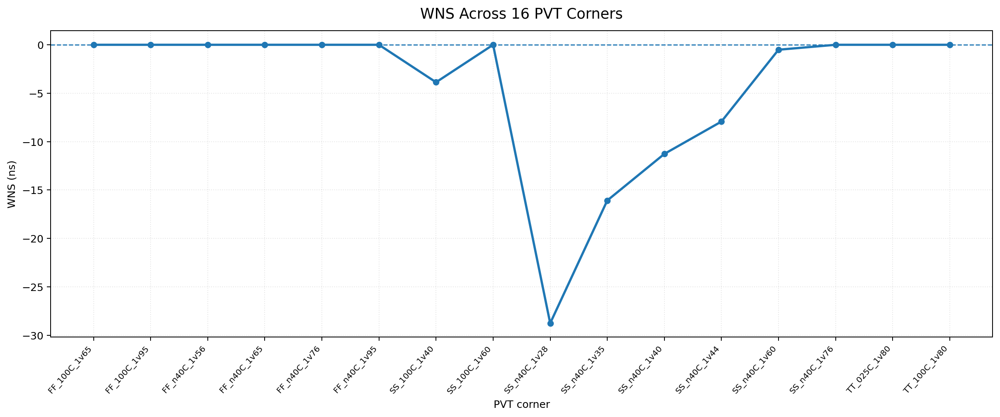
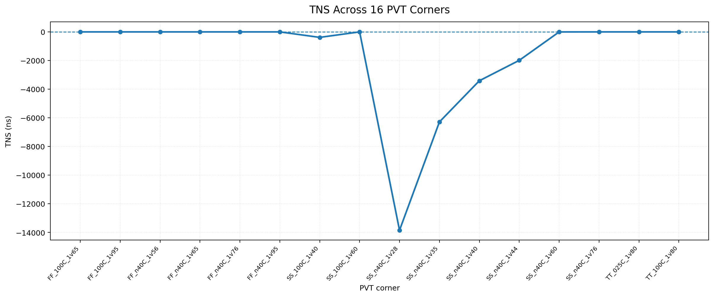
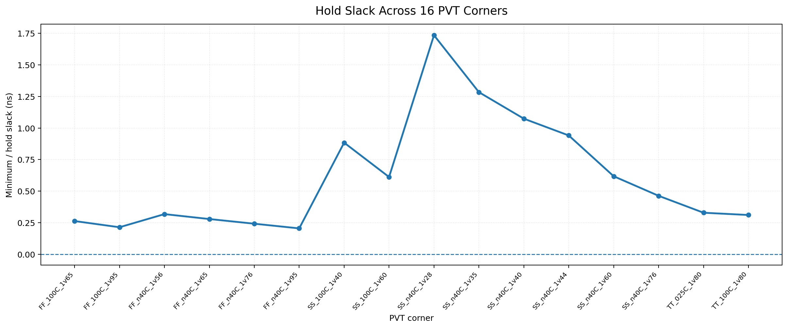
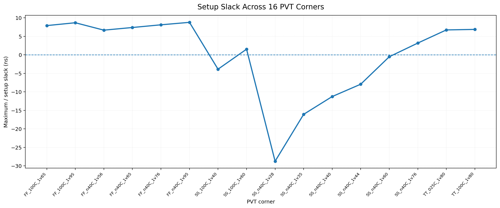

# **VSDBabySoC — Multi-Corner Static Timing Analysis(STA) Review**

## **1. Project Overview**

This alternate report presents a structured review of post-route Static Timing Analysis (STA) for VSDBabySoC using the SKY130 HD standard-cell library and the OpenROAD/OpenSTA toolchain. It covers setup and hold behavior across 16 process, voltage, and temperature (PVT) combinations.

**Report scope**
- **Design:** VSDBabySoC, a RISC-V-based mixed-signal SoC
- **Technology:** SKY130
- **Standard cells:** `sky130_fd_sc_hd`
- **Timing tools:** OpenROAD and OpenSTA
- **Analysis stage:** Post-route timing review
- **PVT corners:** 16
- **Timing metrics:** Setup slack, hold slack, WNS, and TNS

> **Data note:** The values and graphs in this alternate report are modified illustrative examples. They are not measurements from a new OpenROAD run and must not be treated as sign-off results.

## **2. Design Background**

VSDBabySoC integrates a RISC-V processor core with supporting mixed-signal blocks. The major components listed in the source report are the RVMYTH CPU, a phase-locked loop (PLL), and a digital-to-analog converter (DAC).

STA evaluates timing constraints on logic paths without simulating every possible input combination. Checking several PVT corners helps identify operating conditions where the timing margins become smaller or violations occur.

## **3. Goals of the Review**

1. Evaluate setup requirements at each listed PVT corner.
2. Check minimum-delay behavior for hold timing.
3. Identify corners with the weakest timing margins.
4. Compare WNS and TNS across operating conditions.
5. Identify where further timing investigation may be necessary.

## **4. Tools and Technology**

| **Item** | **Description** |
|---|---|
| Design | VSDBabySoC |
| Process platform | SKY130 |
| Standard-cell library | `sky130_fd_sc_hd` |
| Synthesis | Yosys |
| Technology mapping | ABC |
| Physical design | OpenROAD / OpenLANE flow |
| STA engine | OpenSTA |
| Timing constraints | SDC |
| Parasitics | Estimated or extracted according to the run setup |

Liberty files describe cell timing and constraints. SDC files define clock and timing requirements, while the physical database and parasitic information contribute implementation-aware delay estimates.

## **5. Flow Overview**

```text
RTL source
   ↓
Synthesis and technology mapping
   ↓
Gate-level netlist
   ↓
Floorplan and placement
   ↓
Clock-tree synthesis
   ↓
Routing
   ↓
Post-route STA
   ↓
Checks at 16 PVT corners
   ↓
WNS / TNS review and critical-path analysis
```

Timing conclusions depend on consistent libraries, constraints, physical data, and parasitic information for each corner.

## **6. PVT Conditions**

PVT refers to **process**, **voltage**, and **temperature**.

- **FF:** fast-fast process condition.
- **SS:** slow-slow process condition.
- **TT:** typical-typical process condition.
- `n40C` represents −40 °C, `025C` represents 25 °C, and `100C` represents 100 °C.
- Voltage labels such as `1v28`, `1v65`, and `1v95` correspond to 1.28 V, 1.65 V, and 1.95 V.

## **7. PVT Corner List**

| **No.** | **PVT corner** | **Process** | **Temperature** | **Voltage** |
|---:|---|---|---:|---:|
| 1 | `FF_100C_1v65` | FF | 100 °C | 1.65 V |\n| 2 | `FF_100C_1v95` | FF | 100 °C | 1.95 V |\n| 3 | `FF_n40C_1v56` | FF | −40 °C | 1.56 V |\n| 4 | `FF_n40C_1v65` | FF | −40 °C | 1.65 V |\n| 5 | `FF_n40C_1v76` | FF | −40 °C | 1.76 V |\n| 6 | `FF_n40C_1v95` | FF | −40 °C | 1.95 V |\n| 7 | `SS_100C_1v40` | SS | 100 °C | 1.40 V |\n| 8 | `SS_100C_1v60` | SS | 100 °C | 1.60 V |\n| 9 | `SS_n40C_1v28` | SS | −40 °C | 1.28 V |\n| 10 | `SS_n40C_1v35` | SS | −40 °C | 1.35 V |\n| 11 | `SS_n40C_1v40` | SS | −40 °C | 1.40 V |\n| 12 | `SS_n40C_1v44` | SS | −40 °C | 1.44 V |\n| 13 | `SS_n40C_1v60` | SS | −40 °C | 1.60 V |\n| 14 | `SS_n40C_1v76` | SS | −40 °C | 1.76 V |\n| 15 | `TT_025C_1v80` | TT | 25 °C | 1.80 V |\n| 16 | `TT_100C_1v80` | TT | 100 °C | 1.80 V |\n
## **8. Timing Metrics**

### **8.1 Setup Slack**

Setup timing checks that data arrives before the capture element's required deadline.

```text
Setup slack = Required arrival time − Data arrival time
```

Positive setup slack means the requirement is met; negative slack indicates a setup violation.

### **8.2 Hold Slack**

Hold timing checks that data remains stable for the required interval after the capture clock edge.

```text
Hold slack = Data arrival time − Required arrival time
```

Positive hold slack indicates the requirement is satisfied; negative slack indicates a hold violation.

### **8.3 WNS and TNS**

**Worst Negative Slack (WNS)** identifies the worst slack for the corner. In this example table, zero is used when no negative setup slack is shown.

**Total Negative Slack (TNS)** sums the negative slack values from violating setup paths. More negative values indicate a larger accumulated timing deficit.

## **9. Modified PVT Timing Table**

The following table is the data source for all four graphs below. Values are in nanoseconds and have been deliberately modified for this alternate example; they are not measured output from a fresh STA run.

| **No.** | **PVT corner** | **Hold slack (ns)** | **Setup slack (ns)** | **WNS (ns)** | **TNS (ns)** | **Setup status** |
|---:|---|---:|---:|---:|---:|---|
| 1 | `FF_100C_1v65` | 0.263 | 7.915 | 0.000 | 0.000 | PASS |\n| 2 | `FF_100C_1v95` | 0.214 | 8.684 | 0.000 | 0.000 | PASS |\n| 3 | `FF_n40C_1v56` | 0.318 | 6.681 | 0.000 | 0.000 | PASS |\n| 4 | `FF_n40C_1v65` | 0.279 | 7.398 | 0.000 | 0.000 | PASS |\n| 5 | `FF_n40C_1v76` | 0.242 | 8.126 | 0.000 | 0.000 | PASS |\n| 6 | `FF_n40C_1v95` | 0.205 | 8.793 | 0.000 | 0.000 | PASS |\n| 7 | `SS_100C_1v40` | 0.884 | -3.874 | -3.870 | -382.640 | FAIL |\n| 8 | `SS_100C_1v60` | 0.612 | 1.536 | 0.000 | 0.000 | PASS |\n| 9 | `SS_n40C_1v28` | 1.735 | -28.764 | -28.760 | -13842.750 | FAIL |\n| 10 | `SS_n40C_1v35` | 1.284 | -16.082 | -16.080 | -6284.190 | FAIL |\n| 11 | `SS_n40C_1v40` | 1.074 | -11.274 | -11.270 | -3410.520 | FAIL |\n| 12 | `SS_n40C_1v44` | 0.941 | -7.936 | -7.930 | -1986.430 | FAIL |\n| 13 | `SS_n40C_1v60` | 0.618 | -0.512 | -0.510 | -2.380 | FAIL |\n| 14 | `SS_n40C_1v76` | 0.463 | 3.187 | 0.000 | 0.000 | PASS |\n| 15 | `TT_025C_1v80` | 0.329 | 6.742 | 0.000 | 0.000 | PASS |\n| 16 | `TT_100C_1v80` | 0.311 | 6.884 | 0.000 | 0.000 | PASS |\n
## **10. PVT Wave Graphs**

Each graph uses the same corner order and values shown in the table.

### **10.1 WNS by PVT Corner**



### **10.2 TNS by PVT Corner**



### **10.3 Hold Slack by PVT Corner**



### **10.4 Setup Slack by PVT Corner**



## **11. Results Discussion**

In these illustrative values:
- The six FF corners and both TT corners show non-negative setup slack.
- `SS_100C_1v40`, `SS_n40C_1v28`, `SS_n40C_1v35`, `SS_n40C_1v40`, `SS_n40C_1v44`, and `SS_n40C_1v60` show negative setup slack.
- The worst example is `SS_n40C_1v28`, with WNS of −28.760 ns and TNS of −13842.750 ns.
- All listed hold-slack values are positive, so this example contains no hold violations.

These conclusions apply only to the modified illustrative values in this document and do not replace the source report's measured results.

## **12. Recommended Next Steps**

1. Inspect detailed timing paths at the worst setup corners.
2. Verify the clock period, clock source, uncertainty, and timing exceptions in the SDC.
3. Review logic depth, cell delay, fanout, and interconnect contributions.
4. Identify whether the analysis uses estimated or extracted parasitics.
5. Make timing changes only after checking the constraints and critical paths.
6. Repeat setup and hold analysis at all required PVT corners after any design changes.

## **13. Conclusion**

Multi-corner STA helps evaluate whether timing requirements are met under varied process, voltage, and temperature conditions. The modified example values show setup violations at selected SS corners while hold slack remains positive throughout the table. Actual closure must be established using the design's real OpenSTA/OpenROAD reports rather than illustrative values.

## **14. References**

- [VSDBabySoC project directory](https://github.com/cpatilabhijith/RTL_Workspace/tree/main/VSDBabySoC)
- [OpenROAD project](https://github.com/The-OpenROAD-Project/OpenROAD)
- [OpenSTA](https://github.com/The-OpenROAD-Project/OpenSTA)
- [SKY130 PDK](https://github.com/google/skywater-pdk)
